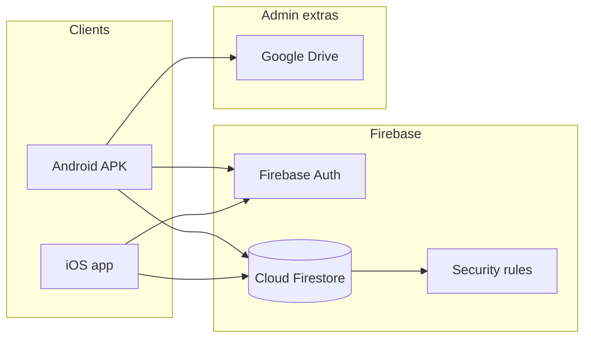

# Gloria Grand EV Charging Management

Mobile app for Gloria Grand (wings B1 and B2) that replaces the paper meter log with charging sessions, shared flat bills, payment verification, Excel/PDF reports, and Google Drive backup.

Current release: **1.5.5** (build 10)  
Android package: `com.gloriagrand.evchargingmanagement`  
Firebase project: `gg-ev-charging-mgmt-1fc01`

## What the app does

- Residents register with email/password and are active immediately.
- Residents start/stop charging at their wing points (`B1-P1`, `B1-P2` or `B2-P1`, `B2-P2`). Admins can use any point.
- Units and amount are calculated from start/end meter readings and the live rate in Firestore (`appConfig/rates`). Default rate is INR 15/kWh.
- Bills, dues, and consumption are combined for every login on the same wing + flat.
- A charge taken at a B1 point by a B2 resident stays on the B2 bill.
- The next start at a point must be greater than that point’s last end meter. Admins can correct a wrong last reading.
- Residents submit a UPI/bank transaction reference. Admins mark it paid or rejected.
- Admins download an all-users Excel or PDF for the selected month, and can upload the Excel to Google Drive.

## Screens

| Screen | Who | Purpose |
| --- | --- | --- |
| Login / Register | Everyone | Email/password auth |
| Dashboard | Everyone | Welcome, dues/consumption snapshot, version, live point status |
| Start/Stop Charging | Everyone | Meter entry, start/stop, last meter per point |
| View Bills | Everyone | Monthly bill, history, PDF, payment request |
| Admin Panel | Admin | Meter reset, reports, rates, version publish, payments, users |

## Architecture



Billing, invoices, and reports run in the Flutter app. There is no required monthly Python job for residents to get a bill.

## Repository layout

```
mobile/                 Flutter Android + iOS app
infra/firebase/         Firestore rules and indexes
docs/                   Product, software, and operations docs
services/billing/       Optional Python invoice helper (not used by the live app)
```

## Documentation

- [Software documentation](docs/software-documentation.md)
- [Software and system flow](docs/system-flow.md)
- [Data model](docs/data-model.md)
- [Product requirements](docs/product-requirements.md)
- [Deployment runbook](docs/deployment-runbook.md)
- [Payment onboarding](docs/payment-onboarding.md)
- [Payment strategy](docs/payment-strategy-lowcost-to-automation.md)
- [Google Drive backup](docs/google-drive-backup.md)

## Run the app

```bash
cd mobile
flutter pub get
flutter run
```

Release APK:

```bash
cd mobile
flutter build apk --release --build-name 1.5.5 --build-number 10
```

The shareable APK is copied to `mobile/dist/EV_Charging_Management-android-release-v1.5.5.apk`.

Deploy Firestore rules and indexes from the repo root:

```bash
firebase deploy --project gg-ev-charging-mgmt-1fc01 --only firestore:rules,firestore:indexes --config firebase.firestore.json
```

Do not deploy indexes with `--force`. That would delete indexes that exist in the project but are not listed in the file.

## Tests

```bash
cd mobile
flutter test
```

`mobile/test/flat_billing_test.dart` covers shared-flat bills, B1 charges on a B2 home, paid vs rejected payments, and overpay floor at zero.

## Roles and access

- **Resident**: own profile, own sessions, own-wing points, bills for their home flat.
- **Admin**: all points, all sessions/payments, user create/disable, rate, published version, reports, last-meter correction.
- **Disabled**: signed in but blocked from the app until an admin sets status back to `active`.
