# Software and system flow

This document is the operational flow of Gloria Grand EV Charging Management 1.5.5. Boxes are screens or collections that exist in the running app.

## 1. System context

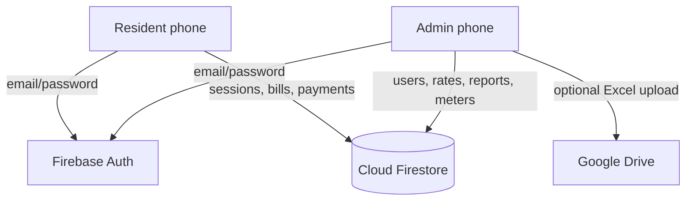

The Flutter app is the only runtime for residents. Firestore holds all durable state. Google Drive is optional and only used from Admin.

## 2. App navigation

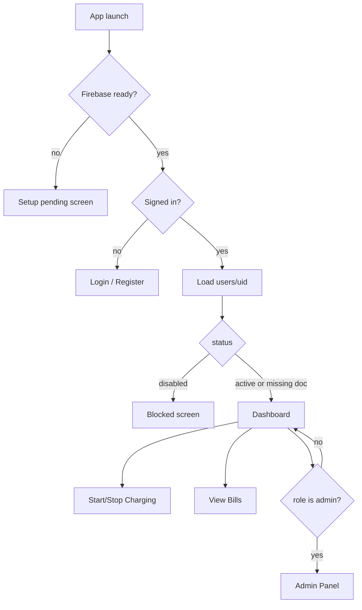

## 3. Register and login

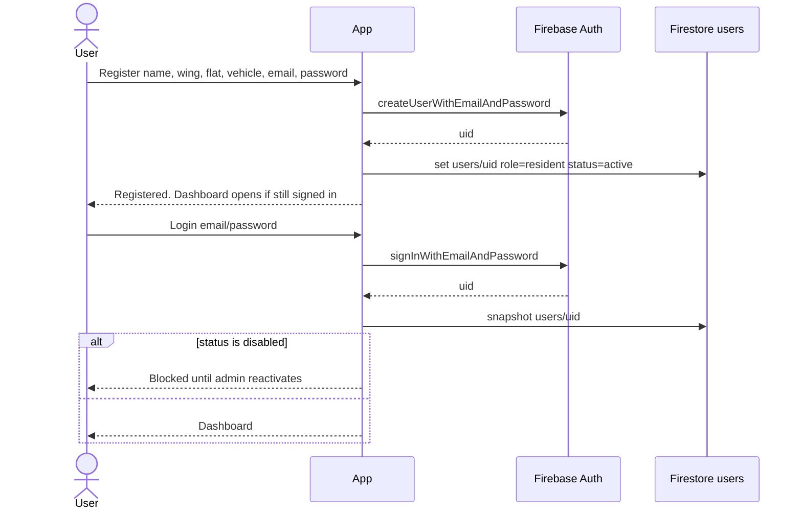

Self-register does **not** wait for admin approval. Admin disable is the only block.

## 4. Start charging

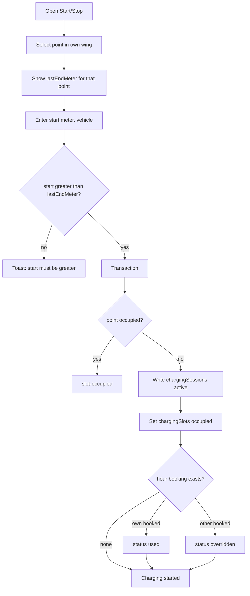

Field split on the session document:

- `wing`, `pointKey` = charger location (`B1-P1` even if the resident lives in B2)
- `billingWing`, `billingFlatKey`, `flatNumber` = home flat for the bill

## 5. Stop charging

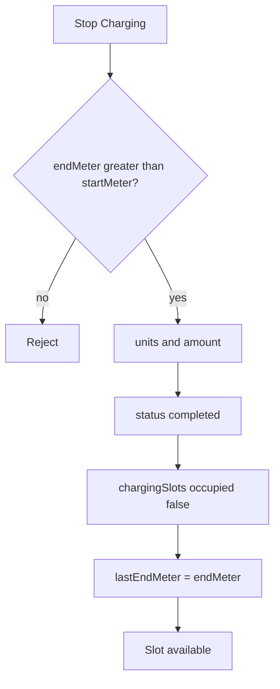

`amount = (endMeter - startMeter) * ratePerUnit` using the rate stored on the session at start.

## 6. Shared flat bill

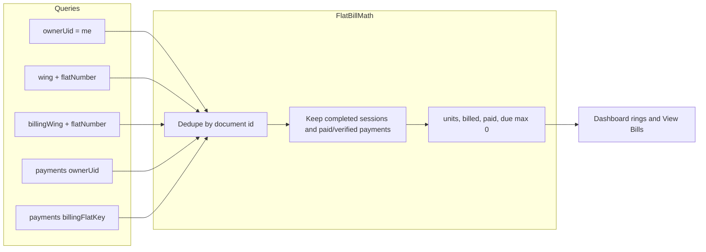

Example: Sahil lives in B2-1102 and charges at B1-P1. The session keeps `wing: B1` and `billingWing: B2`. The B2-1102 bill includes that B1 session. A B1-1102 resident does not see it.

## 7. Payment collection

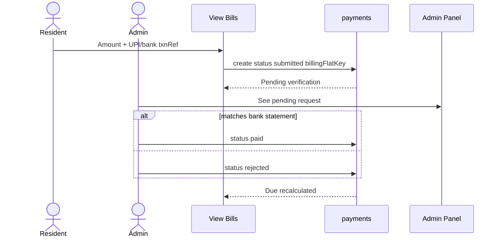

Rules enforced in `FlatPaymentLinker.submitPaymentRequest`:

- Profile must have wing and flat
- One `submitted` request per flat per month
- Same `txnRef` cannot be reused for that flat+month
- Paid/verified reduce due; rejected does not

## 8. Admin report download

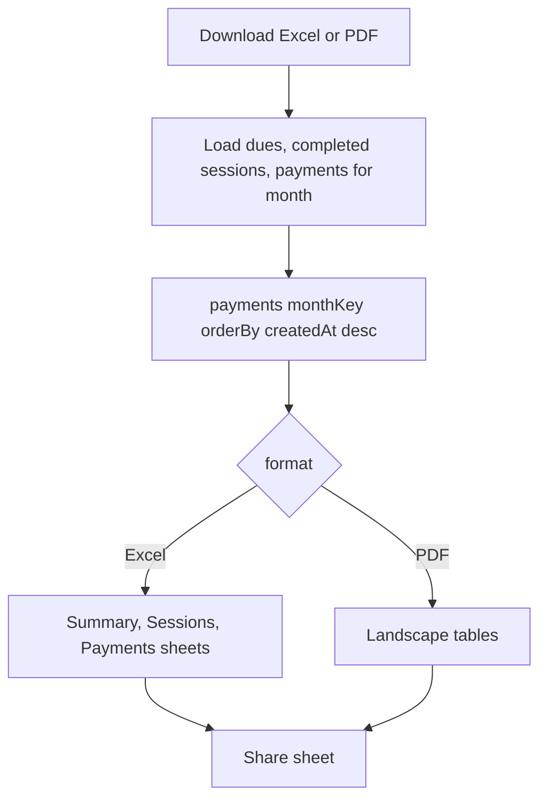

The payments query uses descending `createdAt` because that composite index already exists. The Excel/PDF still lists payments oldest-first.

Drive upload is a separate button: generate Excel locally, then Google Sign-In and upload under `EV Charging Reports/{yyyy-MM}`.

## 9. Last meter correction

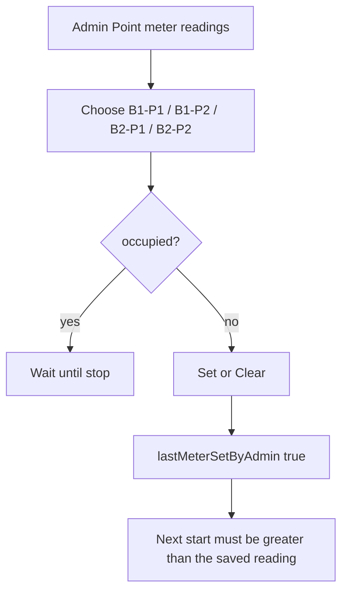

## 10. Data movement

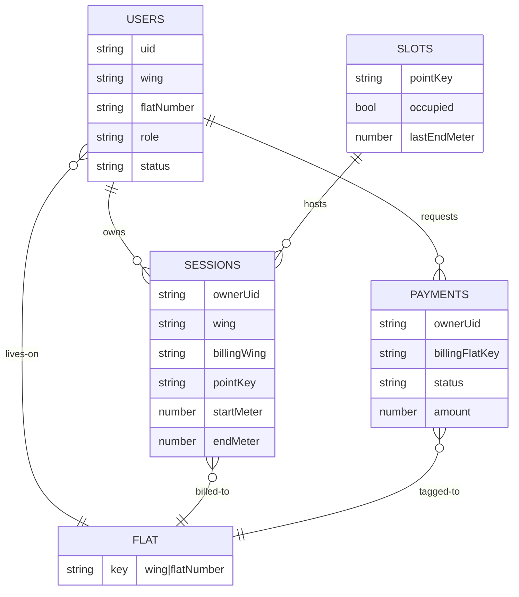

`FLAT` is not a Firestore collection. It is the derived key `wing|flatNumber`.

## 11. Rate and version

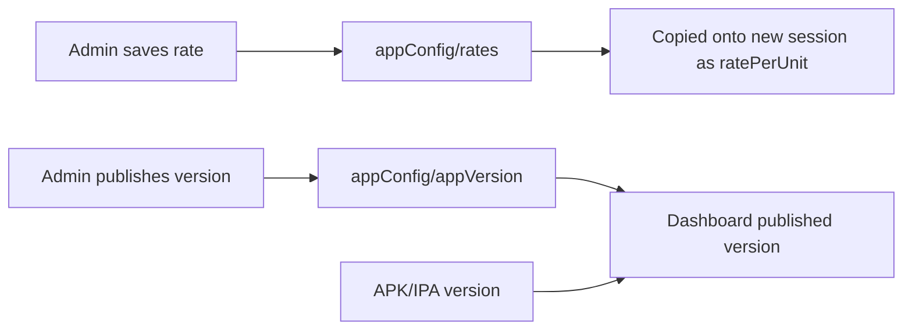

Changing the rate does not rewrite completed sessions. Those keep the snapshot taken at start.
